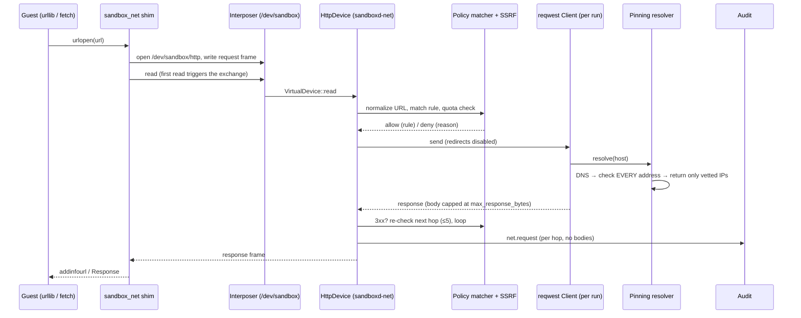

# Cycle 2 Application Design — Network Broker + OTLP

## 1. Components
```
crates/
  sandboxd-net/        NEW  broker: allowlist, URL normalization, SSRF/DNS pinning, HTTP exchange,
                            redirects, TCP, quotas, proxy, TLS trust, net audit, device impls
  sandboxd-policy      ext  rule `scheme`, network timeouts, ensure_supported accepts grants
  sandboxd-audit       ext  LimitKind::Network; NetRequest gains scheme/reason/duration; NetConnect event
  sandboxd-runtime     ext  per-run RunNet → registers devices in VirtualFdTable; guest bootstraps;
                            /usr/local/lib/sandboxd helper mount; RuntimeConfig.broker
  sandboxd-server      ext  [network] config (enabled, proxy, no_proxy, use_env_proxy, extra_ca_file);
                            kill switch at policy load; `otel` feature (OTLP metrics + run spans)
guest/                 NEW  sandbox_net.py, boot.py, boot.mjs (embedded at build time)
tests/escape-suite     ext  E-NET + local HTTP/HTTPS/TCP test servers and a test CA
```

### Data flow (one HTTP request)


## 2. Interfaces (indicative)
```rust
// sandboxd-net
pub struct BrokerConfig { pub proxy: Option<Url>, pub no_proxy: Vec<String>, pub use_env_proxy: bool,
                          pub extra_ca_pem: Option<Vec<u8>> }
pub struct Broker;                       // process-wide: TLS roots + proxy settings, cheap to clone
impl Broker {
    pub fn new(cfg: BrokerConfig) -> Result<Broker, NetError>;
    /// Per-run state; None if the policy grants no egress.
    pub fn for_run(&self, policy: &Policy, run: RunCtx, audit: Arc<dyn AuditSink>) -> Result<Option<RunNet>, NetError>;
}
pub struct RunNet;                       // per-run client (own pool), quotas, counters
impl RunNet {
    pub fn register(&self, vfds: &mut VirtualFdTable);   // "http" and/or "tcp" families
    pub fn finish(&self) -> NetReport;                   // requests, bytes, limit_hit, closes open TCP
}
pub fn normalize_path(p: &str) -> Result<String, Deny>;  // N4.1
pub fn classify_ip(ip: IpAddr) -> IpClass;               // N5.2 (handles v4-mapped / compatible v6)
```

## 3. Architecture Decision Records

### ADR-C2-1 HTTP client: reqwest 0.13 with a pinning resolver (Q1)
- **Context:** we need the OS trust store, an extra CA, an operator proxy, and above all **connect-to-checked-IP** with SNI and verification against the hostname.
- **Decision:** use **reqwest 0.13.5**, which is already in the dependency tree via rmcp:
  - Default rustls backend → `rustls-platform-verifier`; `tls_certs_merge` adds `extra_ca_file`.
  - A **custom `Resolve`** does the DNS lookup, rejects the whole name if *any* address is blocked (N5.1), and returns only vetted addresses. reqwest connects only to what the resolver returns, so there's exactly one resolution per connection and the connection is pinned. SNI and verification use the URL hostname, which reqwest does by default.
  - **IP-literal URLs** bypass the resolver, so the broker checks them before sending.
  - `redirect::Policy::none()`: the broker runs the redirect loop itself and re-checks every hop.
  - **One `Client` per run** (its own pool), built from a shared TLS configuration, so connections are never reused across runs.
  - `no_proxy()` by default; the operator proxy is set via `Proxy::all` + `NoProxy`.
- **Alternative rejected:** hyper + hyper-util + tokio-rustls directly. That means more code, and we'd re-implement the proxy and platform-verifier plumbing reqwest already has.

### ADR-C2-2 Device wire protocol: length-prefixed frames (Q2)
- **Request** (guest → `/dev/sandbox/http`): `u32 LE header_len` · JSON `{method, url, headers: [[k, v]], body_len, timeout_ms?}` · `body_len` raw bytes. Bodies are never base64'd: about 33% smaller, and no copy into JSON.
- **The first `read`** after the full frame has been written triggers the exchange. A read before the frame is complete → `EINVAL`.
- **Response:** `u32 LE header_len` · JSON `{status, headers, url, redirects, error?: {code, message}}` · raw body. Errors such as policy denials or quotas come back as a frame with `status: 0` plus `error`, so the shim can raise a precise exception.
- **TCP:** `open("/dev/sandbox/tcp/<host>:<port>")` does policy + SSRF + connect. A denial makes `open` fail with `EACCES`, a refused connection with `ECONNREFUSED`. After that, `read`/`write` are the raw stream.
- **Limits:** the header is ≤ 64 KiB, there are ≤ 100 headers, and the body is ≤ `max_request_bytes`.

### ADR-C2-3 Guest bootstraps (Q3)
- **Helpers** (`guest/*.py`, `guest/*.mjs`) are embedded in the binary, extracted to a hash-keyed cache dir, and mounted read-only at **`/usr/local/lib/sandboxd`**. That path becomes a reserved guest path in the policy.
- **Python:** `python -I -B -S -X frozen_modules=on /usr/local/lib/sandboxd/boot.py /code/main.py <args>`. `boot.py`:
  - puts the helper dir on `sys.path` and installs a `urllib.request` opener with `SandboxHTTPHandler`/`SandboxHTTPSHandler`;
  - patches `socket.create_connection` and `http.client.HTTPConnection.connect` for TCP;
  - sets `sys.argv = argv[1:]`, then calls `runpy.run_path('/code/main.py', run_name='__main__')`;
  - installs a `sys.excepthook` that **trims bootstrap/runpy frames**, so tracebacks look exactly as they did in cycle 1.
- **JavaScript:** `qjs -m /usr/local/lib/sandboxd/boot.mjs /code/main.mjs <args>`. `boot.mjs` defines `globalThis.fetch` (and `Headers`/`Response` subsets) over `qjs:os` I/O on the device, fixes `scriptArgs`, then calls `await import('/code/main.mjs')`.
  - **Amended in C2-U3 (Q1 = A):** `qjs -m -I /usr/local/lib/sandboxd/boot.js /code/main.mjs <args>`. The include runs first as a classic script, so the program isn't wrapped and `scriptArgs` needs no fix.
- **No network grant:** the shims are still installed and raise `PermissionError` / reject with `TypeError('network access is not allowed by policy …')`.

### ADR-C2-4 Proxies and SSRF (Q4)
- **No proxy:** full pinning (ADR-C2-1).
- **With an operator proxy:** the broker resolves and checks the **target** on the host first (N9.2), but the proxy does its own resolution. A DNS answer that changes between our check and the proxy's lookup can't be fully prevented. This is recorded as **residual risk R8**, mitigated by recommending that operators configure their proxy to deny private ranges.
- The proxy host itself is allowed through the resolver; it's operator infrastructure.

### ADR-C2-5 Isolation of connection state (Q5)
Per-run clients and pools; `RunNet::finish` drops them. Cross-run connection reuse is **not** allowed, so a run can't observe or influence another run's TLS sessions or pooled connections.

### ADR-C2-6 OTLP (FR-O1)
`sandboxd-server` gets the cargo feature `otel` (opentelemetry 0.33, OTLP/HTTP). The `RunService` wraps each run in a `sandboxd.run` span and mirrors the Prometheus instruments as OTel instruments. With the feature off, the code compiles out entirely.

## 4. Threat model additions (finalized in C2-U5)
| ID | Threat | Mitigation |
|---|---|---|
| T13 | SSRF to internal services or cloud metadata | Resolver checks every address + pinning; IP-literal pre-check; metadata always blocked |
| T14 | DNS rebinding | Single vetted resolution per connection (pinning) |
| T15 | Redirect to a disallowed target | Broker-managed redirects, every hop re-checked |
| T16 | Request smuggling / header injection | Strict header validation; broker owns framing and hop-by-hop headers |
| T17 | Exfiltration to allowed hosts | Out of the broker's control by design (the operator allows the host); bounded by quotas; fully audited |
| T18 | Cross-run state leakage via connection pools | Per-run clients (ADR-C2-5) |
| R8 | Proxy re-resolution (rebinding through a proxy) | Residual; operator proxy should deny private ranges |
