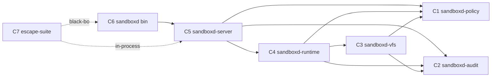

# Component Dependencies — sandboxd

**Rules:**
- No cycles. `policy` and `audit` are leaves.
- `wasmtime`/`wasmtime-wasi` are used only in `runtime` and `vfs`, with versions pinned in the workspace.
- `axum`/`rmcp` are used only in `server`. `clap` is used only in `bin`.
- Only `vfs` (interposer, guest-memory access) and `runtime` may contain `unsafe`, and every use needs a `// SAFETY:` comment and review (NFR-4). Other crates set `#![forbid(unsafe_code)]`.

## Data flow
| From → To | Data |
|---|---|
| Agent → server | `RunRequest` (code, language, policy name, input files ≤ configured size) |
| server → runtime | `RunRequest` + `Arc<Policy>` + event channel |
| runtime ↔ vfs | Mount table, preopens, interposer decisions, artifacts |
| runtime/vfs → audit | `AuditEvent`s (non-blocking) |
| runtime → server → agent | `RunEvent` stream → SSE / MCP progress / CLI stdout |

## Unit mapping (confirmed in Units Generation)
U1 = C1 · U2 = C2 · U3 = C4 · U4 = C3 · U5 = C5 + C6 · U6 = C7 + CI.

**Note on build order:** C4 depends on C3, but the plan order is U3 (runtime) then U4 (vfs). I recommend **swapping them to U4 then U3**, so the runtime is built against a real VFS. Alternatively, U3 can start with a minimal `RunFs` stub. This will be finalized in Units Generation.
