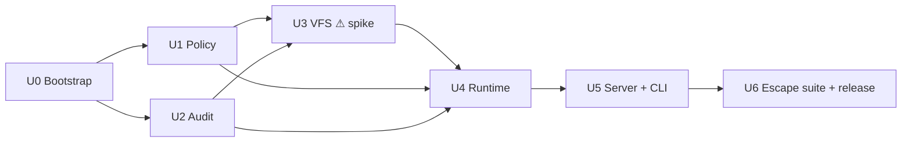

# Unit Dependencies & Sequencing — sandboxd

| Order | Unit | Can run in parallel with | Gate to proceed |
|---|---|---|---|
| 1 | U0 | — | `cargo build` + CI green on 3 OSes; assets verified by hash |
| 2 | U1, U2 | each other | Unit tests + TOML/YAML parity green |
| 3 | U3 | — | **ADR-001 spike go/no-go decision (needs your approval)**, then VFS tests green |
| 4 | U4 | — | AC 1, 2, 3, 6 pass via `sandboxd run` |
| 5 | U5 | — | AC 7, 8 pass |
| 6 | U6 | — | AC 4, 5, 9, 10 + full escape suite green on 3 OSes |

**Cross-unit risk:** if the ADR-001 spike fails, U3 falls back to mount-level audit. U4–U6 are unaffected. FR-6.1 is then recorded as a known gap, and Phase 4 networking will need custom interpreter builds (ADR-002, option B).
