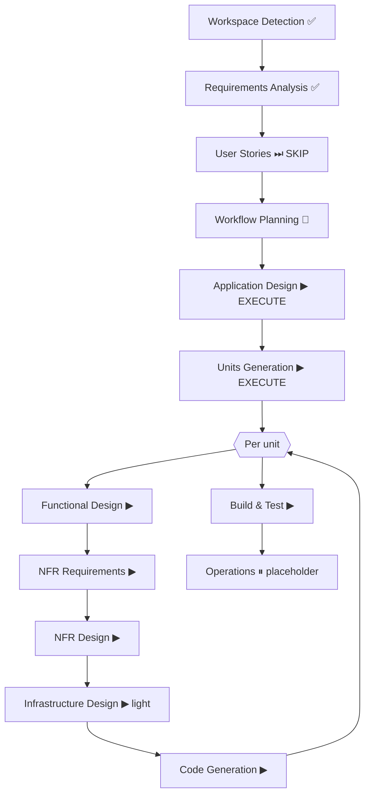

# Execution Plan — sandboxd

**Date:** 2026-11-18 · **Inputs:** approved `requirements.md` (raw TCP kept in the broker design, off by default)

## Change impact analysis

| Dimension | Assessment |
|---|---|
| Project type | Greenfield, Rust workspace |
| User-facing impact | New CLI, HTTP API and MCP tool |
| Structural impact | High: about 6 cooperating components with trait seams for phases 4–5 |
| Data model | Policy schema (v1), run request/result, audit event schema |
| API impact | New public contracts (HTTP `/v1`, MCP tools, CLI). Treat them as stable once released |
| NFR impact | High: security (release-blocking escape suite), 3-OS CI, latency targets |
| Risk | **High.** Security product, WASI interpreter quirks, Windows parity |

## Workflow visualization

## Stage decisions

### INCEPTION
| Stage | Decision | Rationale |
|---|---|---|
| Workspace Detection | ✅ Done | Greenfield |
| Reverse Engineering | ⏭ Skip | No existing code |
| Requirements Analysis | ✅ Done | Approved 2026-11-18 |
| User Stories | ⏭ Skip | Q20=A; acceptance criteria in requirements §6 |
| Workflow Planning | 🔄 This document | |
| **Application Design** | ▶ Execute | New system needs component boundaries, trait seams (`Interpreter`, `InstancePool`, `NetworkBroker`, `FallbackBackend`, `AuditSink`), and the two open decisions (network bridge, QuickJS sourcing) |
| **Units Generation** | ▶ Execute | Work splits into independently buildable and testable crates |

### CONSTRUCTION (per unit; depth scaled to the unit)
| Stage | Decision | Rationale |
|---|---|---|
| Functional Design | ▶ Execute | Policy schema/merge rules, limit semantics, VFS mount rules and the MCP/HTTP contracts need precise definition |
| NFR Requirements | ▶ Execute | Security baseline is blocking (Q14), plus latency targets and 3-OS support |
| NFR Design | ▶ Execute | Threat model, limiter design, redaction, auth, cache integrity |
| Infrastructure Design | ▶ Execute (light) | No cloud. Scope: GitHub Actions 3-OS matrix, release packaging, wasm asset pinning, `cargo deny`/`audit` |
| Code Generation | ▶ Always | |
| Build and Test | ▶ Always | Unit tests, integration tests, golden TOML/YAML parity, escape suite |

### OPERATIONS
⏸ Placeholder. Not executed this cycle.

## Preliminary unit breakdown (to be confirmed in Units Generation)

| # | Unit (crate) | Covers | Depends on |
|---|---|---|---|
| U1 | `sandboxd-policy` | FR-4 (TOML+YAML → canonical schema v1, validation, tighten-only overrides) | — |
| U2 | `sandboxd-audit` | FR-6 (JSONL sink, OTLP optional, event schema) | — |
| U3 | `sandboxd-runtime` | FR-1, FR-2, FR-8 seams (wasmtime engine, fuel/epoch/memory, interpreter embedding + compile cache, native-ext detection) | U1, U2 |
| U4 | `sandboxd-vfs` | FR-3 (preopens, in-memory inputs, `/out` artifacts, caps) | U1, U2 |
| U5 | `sandboxd-server` + `sandboxd` bin | FR-5 (CLI, axum HTTP + SSE, MCP stdio + Streamable HTTP, bearer auth, concurrency limiter) | U1–U4 |
| U6 | `escape-suite` + CI | NFR-1, NFR-4 (adversarial tests, 3-OS matrix, cargo deny/audit) | U5 |

FR-7 (network broker) appears only as a trait plus policy schema in U1/U3, with no implementation.

**Build order:** U1 → U2 → U3 → U4 → U5 → U6. U1 and U2 can be built in parallel.

## Success criteria
- All 10 acceptance criteria in requirements §6 pass on Linux, macOS and Windows.
- `cargo deny check` and `cargo audit` are clean. The escape suite is green.
- The threat model document has been reviewed.

## Toolchain step (before first Code Generation)
Install on Windows: `rustup` (stable, MSVC), the `rustup target add wasm32-wasip1` target, and `cargo install wasmtime-cli` for wasm smoke tests. The MSVC Build Tools are required (I'll check for them).
